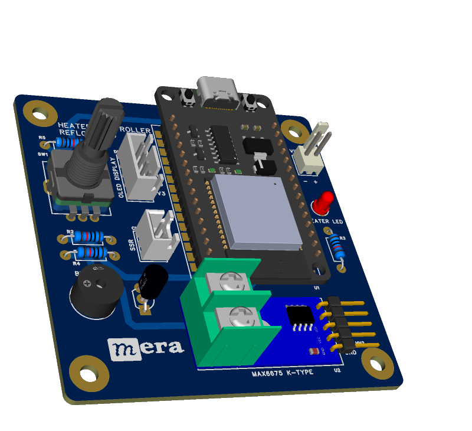
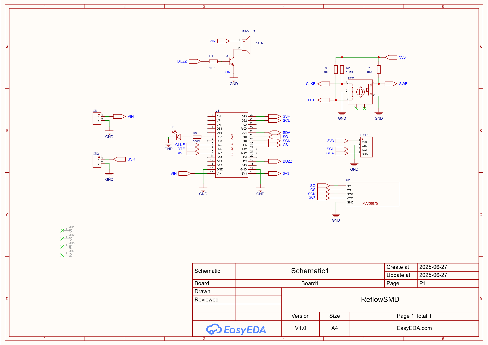
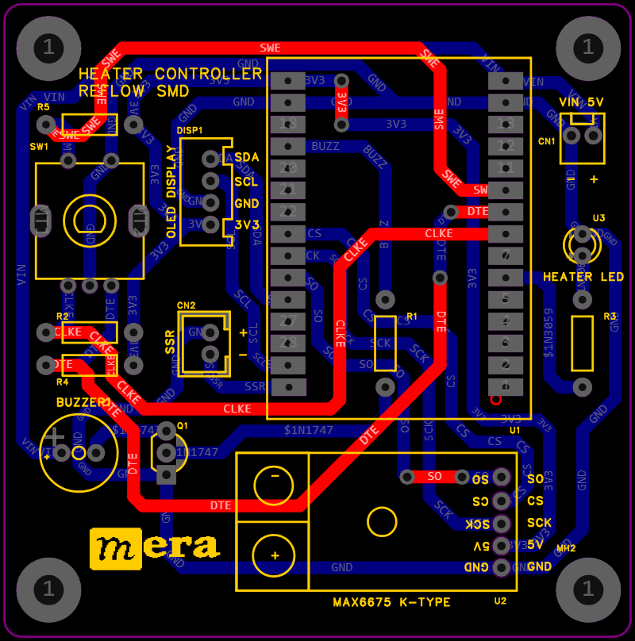

# Reflow_SMD

PID regulator temperature za lemljenje SMD komponenti (reflow) na ploči zagrevanoj **grejačem od pegle (800 W)**.
Upravljanje: **ESP32** + **MAX6675** (termopar tip K) + **SSR**, sa OLED ekranom i rotacionim enkoderom.

> Firmware and hardware design for an ESP32-based reflow hot plate (800 W iron heater, MAX6675 K-type thermocouple, SSR, PID control).



---

## Sadržaj

- [Mogućnosti](#mogućnosti)
- [Hardver](#hardver)
- [Instalacija firmvera](#instalacija-firmvera)
- [Korišćenje](#korišćenje)
- [Bezbednost](#bezbednost)
- [Serijski log i podešavanje PID-a](#serijski-log-i-podešavanje-pid-a)
- [Struktura repozitorijuma](#struktura-repozitorijuma)
- [Verzije](#verzije)

## Mogućnosti

- Održavanje zadate temperature 50–250 °C, PID sa vremenskim PWM-om (prozor 2 s) preko SSR-a
- Gain scheduling: Ki se automatski bira prema zadatoj temperaturi (≤160 °C / 161–180 °C / >180 °C)
- OLED meni (SH1106 128×64): **SET** temperatura, **BEEP** zvuk ON/OFF, **START/STOP**
- Prikaz trenutne snage grejača u % i LED indikator aktivnog zagrevanja
- Signal i tajmer kada se dostigne zadata temperatura, brzi izbor 150 / 180 / 220 / 240 °C (v1.2)
- **Zaštite (v1.1):** otkaz termopara, apsolutna granica temperature, provera rasta temperature, blokada START-a
- CSV log na serijskom portu za praćenje i podešavanje PID-a

## Hardver

| Komponenta | Opis |
|---|---|
| ESP32 DevKit (ESP32-WROOM) | mikrokontroler |
| MAX6675 modul + termopar tip K | merenje temperature (0–1024 °C, rezolucija 0,25 °C) |
| SSR (npr. Fotek SSR-25DA, zero-cross) | prekidanje grejača 230 V AC |
| Grejač pegle 800 W | zagrevanje ploče |
| OLED SH1106 1.3" I²C | ekran |
| Rotacioni enkoder sa tasterom (EC11) | upravljanje |
| Buzzer + BC337 | zvučni signali i alarm |
| LED + 330 Ω | indikator zagrevanja |

Detaljan raspored pinova, šema i napomene o povezivanju 230 V dela: **[docs/HARDWARE.md](docs/HARDWARE.md)**

| Šema | PCB |
|---|---|
|  |  |

## Instalacija firmvera

1. Arduino IDE 2.x sa ESP32 podrškom (*esp32 by Espressif Systems*), ploča **ESP32 Dev Module**.
2. Biblioteke (Library Manager):

   | Biblioteka | Autor | Testirana verzija |
   |---|---|---|
   | U8g2 | olikraus | 2.36.x |
   | MAX6675 library | Adafruit | 1.1.2 |
   | RotaryEncoder | Matthias Hertel | 1.6.0 |
   | PID | Brett Beauregard | 1.2.0 |

3. Otvorite `Smd_Reflow_PID_Final.ino` (fajl `mera_logo.h` mora biti u istom folderu) i uploadujte.

Ili preko `arduino-cli`:

```bash
arduino-cli compile --fqbn esp32:esp32:esp32 .
arduino-cli upload  --fqbn esp32:esp32:esp32 -p COM3 .
```

## Korišćenje

Okretanjem enkodera bira se stavka menija, pritiskom se aktivira:

| Stavka | Akcija |
|---|---|
| **SET** | kratak pritisak ulazi u izmenu (treperi `<<<`), okretanjem se menja temperatura 50–250 °C, ponovni pritisak potvrđuje |
| **SET**, dug pritisak (0,8 s) | brzi izbor: prelazi na sledeću vrednost **150 → 180 → 220 → 240 °C** (dva kratka pištanja) |
| **BEEP** | uključuje ili isključuje zvuk tastera (alarm i signal dostignute temperature se **uvek** čuju) |
| **START / STOP** | pokreće ili zaustavlja regulaciju; dok radi prikazuje snagu grejača u % |

**Temperatura dostignuta:** kada temperatura prvi put uđe u opseg SET ±2 °C, čuju se **3 kratka pištanja**, a u gornjem redu ekrana se umesto `Temp :` prikazuje tajmer od tog trenutka (npr. `219.6°C   T 0:45`).
Promena SET vrednosti resetuje signal i tajmer. Brze vrednosti se menjaju u nizu `PRESET_TEMPS` na vrhu `.ino` fajla.

Ako senzor ne radi, na ekranu piše `TEMP ERROR!` i `START BLOCKED`, a proces ne može da se pokrene.

### Preporučeni ručni profil (Sn63/Pb37, olovni lem)

Firmver v1.1 drži jednu temperaturu, pa se profil izvodi ručnom promenom SET vrednosti:

1. **Predgrevanje / soak:** dug pritisak na SET dok ne bude **150 °C**, START. Posle signala držati 60–90 s (tajmer na ekranu).
2. **Reflow:** dug pritisak na SET dok ne bude **220 °C**. Posle signala sačekati da se lem rastopi i zasija, pa držati još 30–60 s.
3. **Hlađenje:** skinuti PCB sa ploče i STOP (ne pomerati komponente dok lem ne očvrsne).

Za bezolovni lem (SAC305): soak 150–180 °C, vrh **240 °C**.

Automatski reflow profil namerno nije urađen. Ploča od pegle ima veliku termičku masu, sporo se greje i hladi i ne može da prati profil rerne, pa je ručni rad uz signal i tajmer praktičniji.

## Bezbednost

⚠️ **Uređaj radi sa 230 V i temperaturama preko 200 °C. Ne ostavljajte ga bez nadzora.**

Softverske zaštite (v1.1). Svaka od njih odmah gasi SSR, zaustavlja proces, pušta alarm i prikazuje `!! FAULT !!`:

| Greška | Uslov |
|---|---|
| `SENSOR ERROR` | 3 uzastopna neispravna očitavanja (termopar otkačen, MAX6675 ne odgovara, vrednost van 1–500 °C). Grejač se gasi već kod prvog lošeg očitavanja. |
| `OVER TEMP!` | temperatura > **270 °C**; proverava se i kada proces ne radi (npr. SSR progoreo u kratkom spoju) |
| `NO HEAT RISE` | grejač radi sa ≥90% snage, temperatura je bar 10 °C ispod zadate i ne poraste bar 3 °C za 90 s (termopar ispao sa ploče, pregoreo grejač, SSR ne uključuje) |

Greška se briše pritiskom na taster enkodera, ali samo ako je senzor ponovo ispravan i temperatura ispod granice.
Granice se menjaju u konstantama na vrhu `.ino` fajla (`MAX_SAFE_TEMP`, `NO_RISE_*`, `SENSOR_FAULT_COUNT`).

**Hardverska zaštita je obavezna.** Softver ne može ništa ako ESP32 zakoči ili SSR progori u kratkom spoju. Zadržite originalni bimetalni termostat pegle (postavljen na maksimum) ili termički osigurač **u seriji sa SSR-om**. Više o tome u [docs/HARDWARE.md](docs/HARDWARE.md#bezbednost-230-v-dela).

## Serijski log i podešavanje PID-a

Serijski port: **115200 baud**. Dok proces radi, jednom u sekundi se šalje CSV red:

```
# time_s,temp_c,setpoint_c,output_pct
0.0,24.75,160,100.0
1.0,25.00,160,100.0
...
```

Redovi koji počinju sa `#` su poruke (start, stop, greške, promena PID parametara).
Log se može kopirati u Excel ili LibreOffice i nacrtati kao grafik, a može se pratiti i u Arduino Serial Plotter-u.

PID parametri su na vrhu `.ino` fajla:

| Parametar | Vrednost | Napomena |
|---|---|---|
| `FIXED_KP` | 18.0 | izlaz je 0–2000 ms, pa greška od ~111 °C daje punu snagu |
| `KI_LOW/MID/HIGH_TEMP` | 0.025 / 0.04 / 0.06 | po sekundi |
| `FIXED_KD` | 1.0 | praktično PI regulator |

Saveti za podešavanje: ako temperatura prebacuje zadatu vrednost, smanjite Ki ili povećajte Kd (5–30). Ako sporo dostiže zadatu vrednost, povećajte Kp. Svaku promenu proverite logom.

## Struktura repozitorijuma

```
Smd_Reflow_PID_Final.ino   aktuelni firmver (v1.2)
mera_logo.h                logo za početni ekran
CHANGELOG.md               istorija izmena
docs/
  HARDWARE.md              pinout, povezivanje, bezbednost
  images/                  šema, PCB, 3D prikaz
v1.0/Smd_Reflow_PID_Final/ originalna verzija 1.0 (arhiva)
```

## Verzije

Pogledajte [CHANGELOG.md](CHANGELOG.md). Verzija 1.0 je sačuvana u folderu [`v1.0/`](v1.0/Smd_Reflow_PID_Final) i kao git tag `v1.0`.

## Licenca

[MIT](LICENSE) © me[R]a
