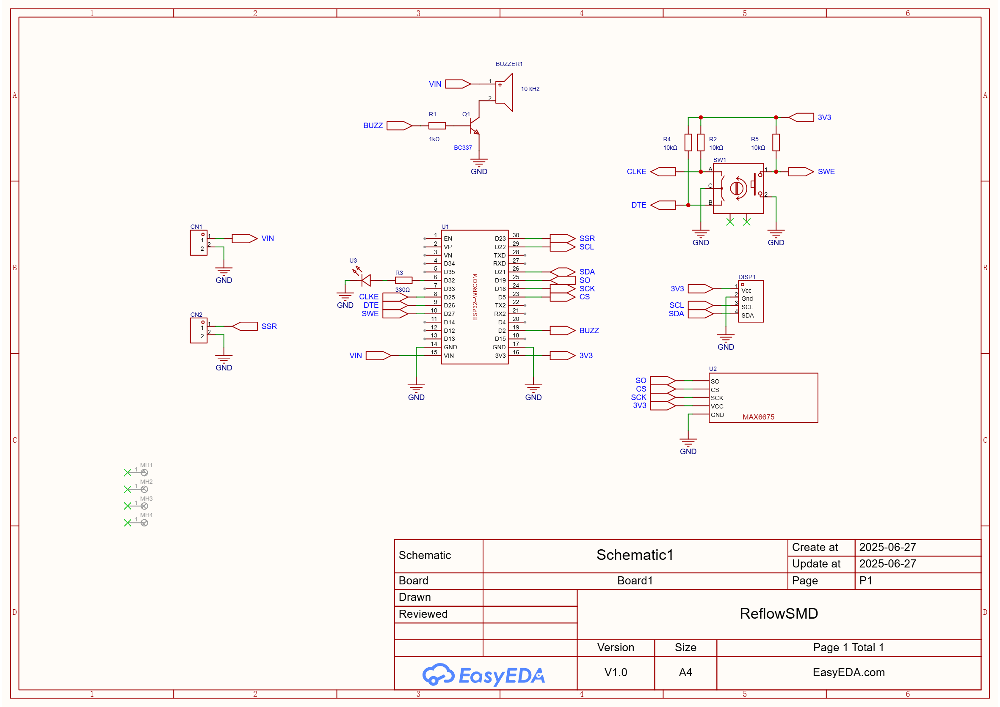
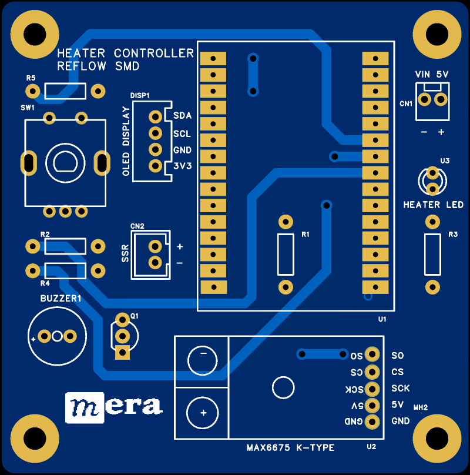
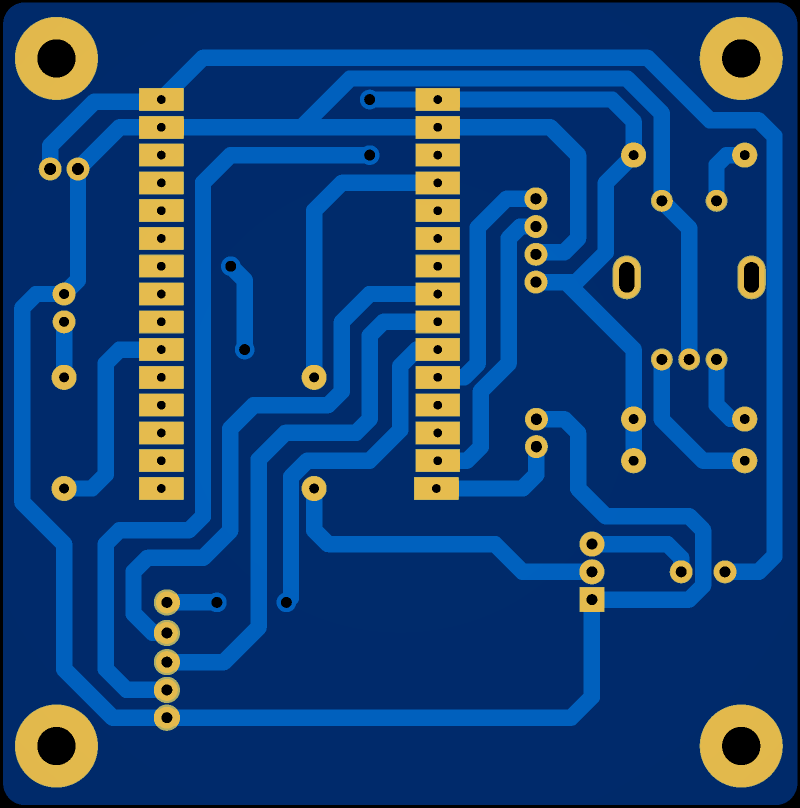
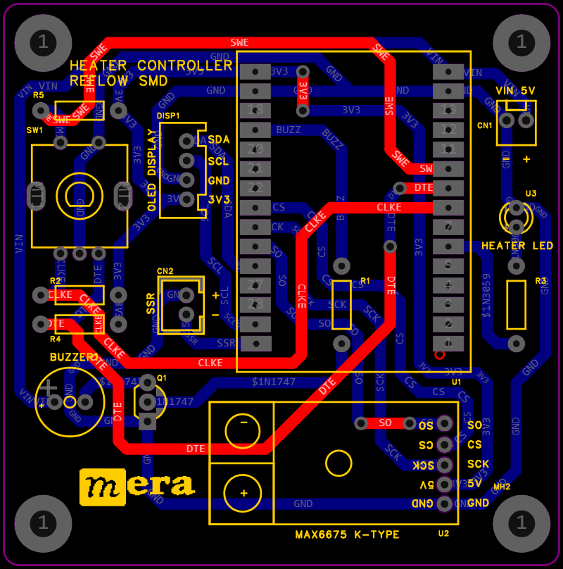
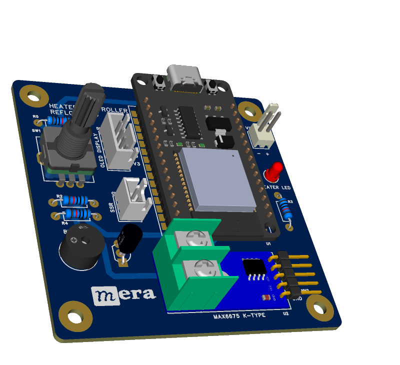

# Hardver

Kontroler je napravljen na jednostranoj ploči (EasyEDA, projekat *ReflowSMD*, v1.0) na koju se utiče ESP32 DevKit.



## Raspored pinova (ESP32)

| Signal | GPIO | Napomena |
|---|---|---|
| SSR | **23** | direktno na ulaz SSR-a (CN2), aktivno HIGH |
| OLED SDA | 21 | I²C, SH1106 128×64, napajanje 3,3 V |
| OLED SCL | 22 | |
| MAX6675 SO | 19 | SPI (softverski), napajanje 3,3 V |
| MAX6675 SCK | 18 | |
| MAX6675 CS | 5 | |
| Enkoder CLK | 25 | pull-up 10 kΩ na 3,3 V (R2) |
| Enkoder DT | 26 | pull-up 10 kΩ na 3,3 V (R4) |
| Enkoder SW | 27 | pull-up 10 kΩ na 3,3 V (R5), aktivno LOW |
| Buzzer | 2 | preko R1 1 kΩ na bazu BC337 (Q1); buzzer je napajan sa VIN |
| LED "heater" | 32 | preko R3 330 Ω |

Napajanje: **5 V na CN1 (VIN)**.

## Konektori

| Konektor | Namena |
|---|---|
| CN1 | VIN 5 V / GND |
| CN2 | izlaz za SSR (+ = GPIO23, − = GND) |
| DISP1 | OLED (SDA, SCL, GND, 3V3) |
| U2 | MAX6675 modul, termopar tip K na stezaljke |

## Slike ploče

| Gornji sloj | Donji sloj |
|---|---|
|  |  |





## Povezivanje 230 V dela

```
 L ──[osigurač 6,3 A]──[termostat pegle / termički osigurač]──[SSR 1-2]──[ GREJAČ 800 W ]── N
                                                                 │
                                       GPIO23 (CN2 +) ──── SSR 3 (+)
                                       GND    (CN2 −) ──── SSR 4 (−)
 PE ── metalno kućište / ploča grejača
```

- **SSR:** zero-cross tip sa DC ulazom 3–32 V (npr. SSR-25DA). Struja grejača je ~3,5 A, pa SSR od 25 A ima veliku rezervu, ali mu treba **hladnjak**. Kineski SSR-ovi su često precenjeni.
- **Termopar:** vrh termopara mora biti u dobrom termičkom kontaktu sa pločom, idealno u rupi ili pritisnut ispod pločice blizu mesta gde stoji PCB. Loš kontakt daje kašnjenje, a kašnjenje daje prebačaj temperature.
- **Uzemljenje:** metalni delovi pegle i ploča grejača moraju biti na zaštitnom provodniku (PE).

## Bezbednost 230 V dela

Softver (v1.1) gasi grejač kod otkaza senzora, previsoke temperature i kada temperatura ne raste. **Ali softver ne pomaže ako:**

- SSR progori u kratkom spoju (najčešći kvar SSR-a), jer je grejač tada stalno uključen bez obzira na GPIO;
- ESP32 zakoči sa GPIO23 u stanju HIGH.

Zato u seriju sa grejačem obavezno ide **nezavisna hardverska zaštita**:

1. **originalni bimetalni termostat pegle**, postavljen na maksimum (isključuje na ~220–250 °C), i/ili
2. **termički osigurač** (npr. 240 °C ili 260 °C, 10 A) pričvršćen na ploču grejača.

Firmver u slučaju previsoke temperature pušta alarm i kada proces ne radi, tako da kvar SSR-a bar bude čujan.
